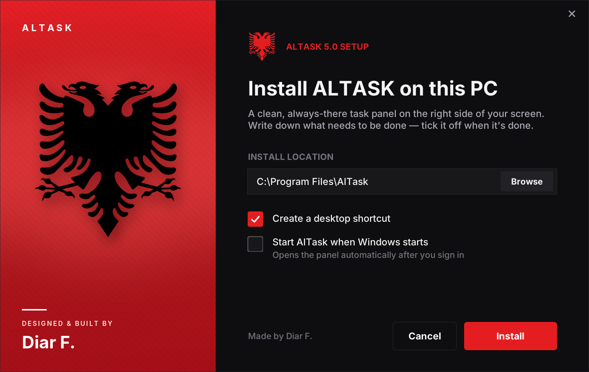

<h1 align="center">ALTASK</h1>

A clean, always-there task panel docked to the right side of your Windows screen. 
<b>Designed &amp; built by Diar F.</b>

  <a href="https://github.com/whatsthatbrother/altask/releases/latest/download/AlTask-Setup.exe"><b>⬇ Download AlTask for Windows</b></a>
  &nbsp;·&nbsp;
  <a href="https://whatsthatbrother.github.io/altask/">Website</a>

## Features
- Docked to the right edge of the screen, collapsible, resizable
- To do / Completed lists, edit with a double-click, undo with Ctrl+Z
- Asks before deleting
- Light and dark theme (or follow Windows), three text sizes
- Always on top, start with Windows
- Updates itself: when a new version is out, AlTask shows **Update available** and installs it with one click (checksum-verified)

Works on Windows 10 and 11. Your tasks are stored in `%APPDATA%\DetyratNote\tasks.json` and are kept across updates.
Upgrading from **Tasks 4.x** moves the install to `C:\Program Files\AlTask` automatically — your tasks stay.

## Releasing a new version
1. Change `VERSION` in `Tasks.pyw` **and** `Setup.pyw` (e.g. `5.1`) and the numbers in `version_info.txt` / `setup_version_info.txt`
2. Write what's new in `notes.txt`
3. Commit and push to `main`

GitHub Actions sees the new version, builds `AlTask-Setup.exe` on Windows and publishes release `v5.1`.
Every installed copy of AlTask sees it within the hour.

## Website
The site lives in [`docs/`](docs/) and is served by GitHub Pages at https://whatsthatbrother.github.io/altask/

## Building locally
`build.bat` (needs Python 3.10+ for Windows). Output: `dist\AlTask-Setup.exe`.
